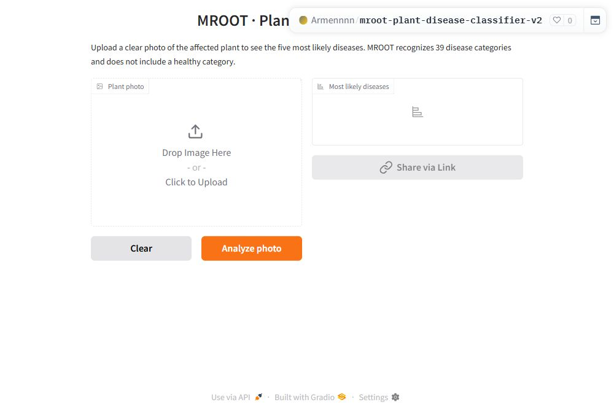

# MROOT Plant Disease Classifier

MROOT predicts the disease shown in a plant photo. I built it as my Machine
Learning Engineering capstone at Armenian Code Academy. It recognizes **39
disease categories**, independent of the plant species. It does not include a
healthy category.

**[Try the final app](https://huggingface.co/spaces/Armennnn/mroot-plant-disease-classifier-v2)**
or use the [direct upload interface](https://armennnn-mroot-plant-disease-classifier-v2.hf.space/).



## What changed in V2

The first deployment averaged three EVA-02 Small models at 336 pixels. The final
deployment averages **two EVA-02 Base models at 448 pixels**:

- A clean control run, selected at epoch 7.
- A run with MixUp/CutMix, selected at epoch 11.

I checked data quality, compared sampling and fine-tuning choices, then compared
the models' contribution to an ensemble. More models did not consistently help.
The final pair gave the highest macro mAP among the final validation comparisons.
The [original three-model app](https://huggingface.co/spaces/Armennnn/mroot-plant-disease-classifier)
remains available. The repository's earlier commits preserve the V1 source.

## Results

| Evaluation | Images | Macro mAP | Top-1 accuracy | Top-5 accuracy |
| --- | ---: | ---: | ---: | ---: |
| Final model-selection validation subset | 368 | 96.4825% | 91.3043% | 99.4565% |
| Final fixed holdout subset | 623 | 92.9896% | 89.4061% | 99.3579% |

On the 623-image subset, the final system classified 557 images correctly at
Top-1 and included the correct disease in the first five predictions for 619.
The preceding four-model system scored 92.5852% mAP and 88.1220% Top-1 on the
**same** 623 images. The final pair added eight correct Top-1 predictions.

**mAP is not accuracy.** Macro mAP averages each disease's average precision, so
rare classes count equally. Top-1 measures the fraction with the correct first
prediction. The 96.48% figure is validation mAP, not final-test accuracy.

The control and MixUp/CutMix checkpoints came from per-epoch validation on 388
images. The 368 images form a subset used for fair comparisons with older models
that had historical image copies in their training data. These are not two
independent validation/test sets. Do not compare scores from 390, 388, and 368
images as if they used identical samples.

The final model choice and preprocessing were frozen before its final holdout
evaluation. However, this holdout had already been evaluated with earlier
systems. It is **not a pristine unseen test set**. The validation set is small
and reused, and the paired bootstrap intervals include zero. A new external test
set would be needed for a stronger estimate of generalization.

See [the experiment log](docs/experiments.md), [evaluation protocol](docs/evaluation.md),
and the original CSV/JSON artifacts in [reports/raw](reports/raw).

## Run locally

Use Python 3.12. The default requirements install CPU PyTorch. A machine with
several GB of available RAM is needed to load both Base models.

```bash
git clone https://github.com/abarseghian2005-collab/mroot-plant-disease-classifier.git
cd mroot-plant-disease-classifier
python -m venv .venv
```

Activate the environment with `.venv\Scripts\activate` on Windows or
`source .venv/bin/activate` on Linux/macOS, then:

```bash
python -m pip install -r requirements.txt
python scripts/download_models.py
python app.py
```

The model download is about 691 MB. The script fetches the two safetensors files
from a pinned Hugging Face revision and checks their SHA-256 hashes. It needs no
token for these public files. Large weights and training images stay outside Git.

The loader preserves the Space's relative layout under the local `models/`
directory. This results in `models/models/*.safetensors`, with `ensemble.json`
beside that inner folder. Set `MROOT_MODEL_DIR` to choose another cache directory.

## REST API

```bash
uvicorn src.mroot.api:app --host 0.0.0.0 --port 8000
```

Open `http://localhost:8000/docs`, or send an image:

```bash
curl -X POST http://localhost:8000/predict -F "file=@leaf.jpg"
```

`GET /health` reports service health without loading the models. `POST /predict`
accepts a JPEG, PNG, or WebP image and returns the first prediction plus the five
highest disease scores. Input validation rejects unreadable images, files larger
than 20 MB, and images above 25 million pixels. Inference requests run one at a
time. This FastAPI service is an additional local/container entry point. The live
Hugging Face app uses Gradio's prediction endpoint.

## Inference recipe

Each model uses its own saved `data_cfg`, including bicubic interpolation, EVA
normalization, and the saved `squash` resize setting. For each model:

```text
p_model = 0.375 * p_normal + 0.375 * p_horizontal_flip + 0.25 * p_whole_image_pad
p_final = 0.5 * p_control_epoch7 + 0.5 * p_mixup_cutmix_epoch11
```

The padded view keeps the full image and fills the remaining area with the saved
mean RGB color. Scores are softmax probabilities. They are not calibrated
diagnostic certainty. CPU inference uses float32. The deployed ZeroGPU version
also uses float32, while the training evaluation used mixed precision.

Both deployed weight files passed remote checksum verification. A live prediction
matched the local GPU result within 0.0000012 probability and took about 3.09
seconds including the queue. This is one smoke test, not a latency benchmark.
See [the verification record](reports/live_deployment_verification.json).

## Data, EDA, and training

The final paired experiment used 6,790 training and 388 validation images after
quarantining detected image groups and label-conflict candidates. The earlier
split had 6,870 training and 390 validation images. The original files remain
unchanged. [Data access and split details](data/README.md) explain the exact
manifests and the 623-image reporting subset.

- [01 EDA](notebooks/01_eda.ipynb) explores class counts, image sizes, missing data,
  split integrity, and correlations between image metadata features.
- [02 Experiments](notebooks/02_experiment_review.ipynb) reviews the actual saved
  epoch curves and ensemble comparisons without running models again.
- [03 Training recipe](notebooks/03_training_recipe.ipynb) documents how to run an
  explicitly selected arm with the archived initial state.
- [04 Inference](notebooks/04_inference_demo.ipynb) shows how to load the final
  models and predict an image.

The original final-training core is in `src/mroot/train.py`. It validates the
manifests and starting checkpoint, performs validation after every full epoch,
and selects the best normal-view macro mAP checkpoint. It writes new immutable
best checkpoint files and a resumable state in a new output directory. The CLI
wrapper was added during the repository cleanup. We did not repeat training as
part of that cleanup.

Tuning included a controlled learning-rate reduction and a small global ensemble
weight grid with five-fold cross-fitting on cached validation predictions. It
did not include a full neural-network GridSearchCV, Optuna study, or five-fold
retraining. [The tuning record](docs/experiments.md) keeps that distinction clear.

## Repository layout

```text
app.py                    Local Gradio entry point
src/mroot/                Inference, input validation, FastAPI, and training code
scripts/                  Model downloads and saved-result/weight-grid utilities
configs/                  Final training settings and the weighting grid
data/manifests/           Exact final train/validation CSVs, without image bytes
notebooks/                EDA, experiment review, training recipe, inference demo
reports/raw/              Saved experiment configs, histories, and aggregate results
docs/                     Methodology, experiment log, setup and limitations
presentation/             ACA slides and speaking notes
tests/                    Input/schema/API contract tests without large models
.github/workflows/        Automated checks
```

## ACA presentation

The [slide deck](presentation/MROOT_ACA_Presentation.pptx) contains 14 main slides
and six appendix slides. The [speaking notes](presentation/speaking_notes.md)
follow the experiment evidence in a student presentation of about ten minutes.
See the [demo plan](presentation/README.md) for the live demonstration sequence.

## Tests and container

```bash
python -m pip install -r requirements-dev.txt
python -m unittest discover -s tests -v
```

The API contract tests use a small fake predictor so they do not download weights.
The actual model and deployed endpoint have separate smoke-test evidence.

```bash
docker build -t mroot-v2 .
docker run --rm -p 8000:8000 mroot-v2
```

The container starts the FastAPI service and downloads verified weights on its
first prediction if no cache is mounted. See [reproducibility notes](docs/reproducibility.md)
for validation performed during this update and environment limitations.

## Limits and next steps

The model has no healthy or unknown category. It can still give a confident
disease label for an unrelated photo. Visually similar disease names and
remaining label ambiguity also limit interpretation. I would next collect a new
external test set and add reviewed healthy/unknown examples, then compare an
abstention rule on separate development data. I have not implemented or evaluated
those additions here.

## References

- Fang et al., [EVA-02](https://arxiv.org/abs/2303.11331).
- Zhang et al., [mixup](https://arxiv.org/abs/1710.09412).
- Yun et al., [CutMix](https://arxiv.org/abs/1905.04899).
- [timm EVA02 Base model card](https://huggingface.co/timm/eva02_base_patch14_448.mim_in22k_ft_in22k_in1k).
- [Project training notebook](https://www.kaggle.com/code/armenbars/mroot-deploy).

Pretrained weights and source datasets retain their respective terms. This
repository does not grant a separate license to third-party images or weights.
