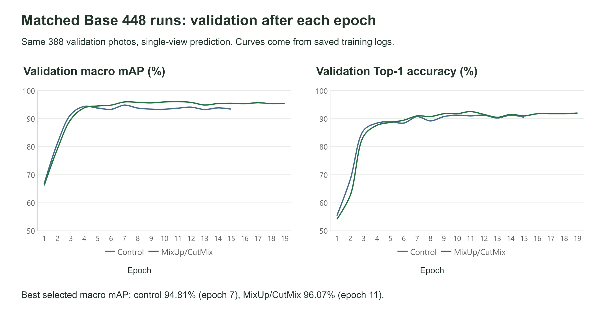
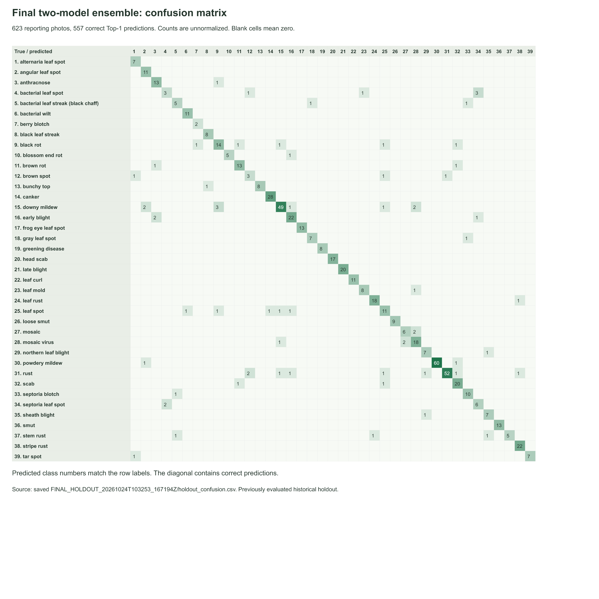

# MROOT Plant Disease Classifier

MROOT classifies plant photos into 39 disease categories and shows the five
highest-scoring suggestions. I built it as my Armenian Code Academy capstone.

**[Try the V2 app on Hugging Face](https://huggingface.co/spaces/Armennnn/mroot-plant-disease-classifier-v2)**

## Final model

V2 averages two fine-tuned EVA-02 Base models at 448 × 448 pixels. One is a
reference run with ordinary augmentation. The other adds MixUp/CutMix, which
mix training images and their label targets. Each model combines predictions
from the resized image, its horizontal flip, and a padded whole-image view.
The two models contribute equally.

I compared sampling and class-weighted loss, model/input size, learning rates,
parameter averaging, and model combinations. More models did not always help.
The final pair had the highest measured macro mAP among the final candidates.

| Evaluation photos | Macro mAP | Top-1 | Top-5 |
| --- | ---: | ---: | ---: |
| Shared validation subset, 368 photos | 96.48% | 91.30% | 99.46% |
| Final reporting subset, 623 photos | 92.99% | 89.41% | 99.36% |

Top-1 checks the first suggestion. Top-5 checks whether the correct label is
among the five suggestions. Macro mAP measures ranking quality and gives every
disease equal importance. It is different from accuracy.

The final runs used 6,790 training and 388 validation photos after related-image
review. Comparisons with older models used 368 shared validation photos to
exclude known historical training copies. The 623 reporting photos came from a
holdout that had already been evaluated earlier. These are development results,
and a new independent photo collection is still needed for a stronger estimate.

## Run locally

Use Python 3.11 or 3.12. From this repository's folder:

```bash
python -m venv .venv
```

Activate the environment on Windows:

```powershell
.venv\Scripts\Activate.ps1
```

Then install dependencies and start the app:

```bash
python -m pip install -r requirements.txt
python app.py
```

Open the local URL printed in the terminal. The first prediction downloads about
691 MB of model files from the public V2 Space. The app pins an exact model
revision, verifies both SHA-256 checksums, and caches files in `.mroot_cache/`.
Later launches reuse that cache. Local inference uses the CPU by default.

`app.py` contains the inference and web interface. `class_mapping.json` fixes
the order of the 39 labels. No training data or large model weights are stored
in this GitHub repository.

## Presentation and experiment history

- [ACA presentation: 10 slides, with Armenian speaker notes](MROOT_ACA_Presentation.pptx)
- [Training and experiment notebook on Kaggle](https://www.kaggle.com/code/armenbars/mroot-deploy)
- [Archived experiment code, notebooks, manifests, and reports](https://github.com/abarseghian2005-collab/mroot-plant-disease-classifier/tree/f046ab5)

## Results from the runs

The matched control and MixUp/CutMix runs used the same 388 validation photos.
Both used EVA-02 Base at 448 input, with the same starting weights and ordinary
training recipe. The candidate added the image/target mixing policy.



Class-level checks showed why the overall score was not the whole story.
Bacterial leaf spot and septoria leaf spot had the lowest AP in the control
run, followed by rust and early blight. Mixing improved early blight AP from
80.43% to 95.32%, but septoria leaf spot fell from 60.18% to 57.91% on the same
validation photos. These are per-class ranking scores, not accuracy, and small
class samples make the estimates uncertain.

The matrix below shows the final two-model system on the 623 reporting photos.
Rows are true classes and columns are predicted classes. Numbers are image
counts, and the diagonal contains the 557 correct first predictions. Click the
image to inspect all 39 classes.

[](confusion_matrix.png)

These figures use the saved training histories and final confusion table.
They do not represent a new evaluation or further tuning on the reporting set.

The original [V1 app](https://huggingface.co/spaces/Armennnn/mroot-plant-disease-classifier)
remains available. It uses the earlier three-model EVA Small ensemble.

## Limits

The model has no healthy or unknown category. It can give a high disease score
for an unrelated image. Similar-looking diseases and changes in lighting,
background, or camera conditions can cause mistakes. Scores are suggestions,
not verified diagnostic probabilities.

## Method references

- [EVA-02](https://arxiv.org/abs/2303.11331)
- [MixUp](https://arxiv.org/abs/1710.09412)
- [CutMix](https://arxiv.org/abs/1905.04899)
